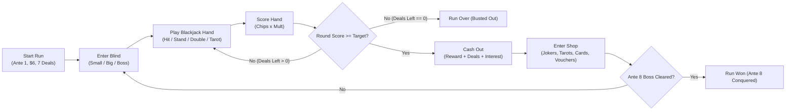
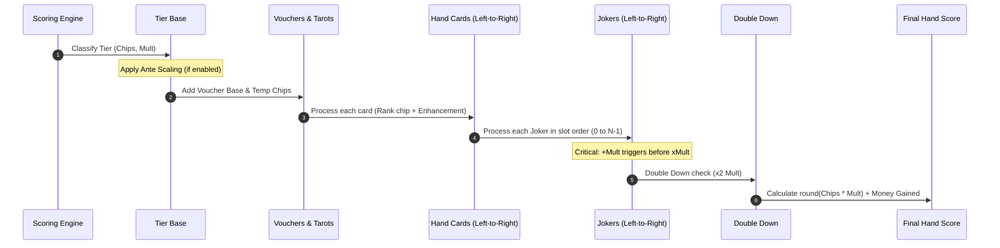
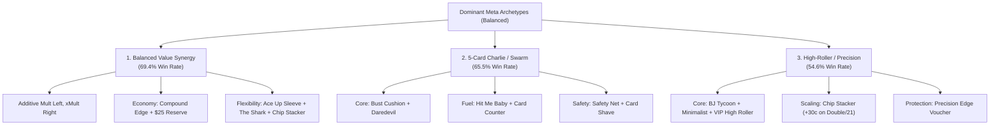

# Jack-latro: Complete Rules, Mechanics, & Mathematical Specification

> **Purpose**: This document serves as the single comprehensive specification for **Jack-latro**, a roguelike deckbuilding game combining the score-scaling cascade of *Balatro* with the probabilistic table dynamics of *Blackjack*. It provides all rules, mathematical formulas, state pipelines, item catalogs, and strategic interactions needed for an AI or human developer to fully understand, simulate, or play the game without inspecting the raw source code.

---

## Table of Contents
1. [Core Gameplay Loop & Objectives](#1-core-gameplay-loop--objectives)
2. [Blackjack Rules & Shoe Engine](#2-blackjack-rules--shoe-engine)
3. [Hand Classification & Tier Hierarchy](#3-hand-classification--tier-hierarchy)
4. [The Scoring Cascade & Mathematical Pipeline](#4-the-scoring-cascade--mathematical-pipeline)
5. [Economy, Payouts, & Interest](#5-economy-payouts--interest)
6. [Ante & Blind Progression Targets](#6-ante--blind-progression-targets)
7. [Catalog of Jokers (All 19)](#7-catalog-of-jokers-all-19)
8. [Catalog of Consumables (Tarots)](#8-catalog-of-consumables-tarots)
9. [Catalog of Vouchers](#9-catalog-of-vouchers)
10. [Boss Blinds & Rotation](#10-boss-blinds--rotation)
11. [Card Enhancements](#11-card-enhancements)
12. [AI Strategic Playbook & Interactions](#12-ai-strategic-playbook--interactions)

---

## 1. Core Gameplay Loop & Objectives

A run of Jack-latro consists of surviving **8 Antes**.
Each Ante contains **3 Blinds**:
1. **Small Blind** (Standard target)
2. **Big Blind** (Higher target, higher cash reward)
3. **Boss Blind** (Double target, boss disruption rule)



### Turn Order & Deal Flow
1. **Start of Blind**: Player is given a quota of deals (default: **7**). Score starts at **0**.
2. **Deal Hand**: Player presses Deal, consuming 1 deal. 2 cards are dealt to Player (face up), 2 to Dealer (1 face up, 1 face down hole card).
3. **Player Turn**:
   - **Hit**: Draw 1 card from the shoe. If total exceeds 21 (or 22 with Bust Cushion), the hand busts immediately. If total is 21 or card count reaches 5, the hand automatically stands.
   - **Stand**: Dealer reveals hole card and draws until dealer total is $\ge 17$.
   - **Double Down**: Allowed only on the initial 2 cards (unless *The Anchor* boss is active). Player draws exactly 1 card, final hand multiplier is multiplied by $2$ ($\times 2\text{ Mult}$), and the hand resolves (dealer hits to $\ge 17$ if player has not busted).
   - **Use Tarot**: Consumables can only be used during an active hand before resolution.
4. **Scoring Resolution**: Hand is classified into a Tier, card and joker bonuses are computed, and the resulting points ($\text{Chips} \times \text{Mult}$) are added to the Blind's running `roundScore`.
5. **Outcome Check**:
   - If $\text{roundScore} \ge \text{targetScore}$: Blind cleared! Remaining deals convert to cash. Player cashes out and enters the Shop.
   - If $\text{roundScore} < \text{targetScore}$ and $\text{dealsLeft} == 0$: Run fails ("Busted Out").

---

## 2. Blackjack Rules & Shoe Engine

### Standard Deck
- A standard run begins with a 52-card deck: 4 suits ($\spadesuit, \heartsuit, \clubsuit, \diamondsuit$) and 13 ranks ($2, 3, 4, 5, 6, 7, 8, 9, 10, \text{J}, \text{Q}, \text{K}, \text{A}$).
- Cards added via shop purchases expand the persistent deck permanently.

### Shoe Mechanics
- The **Shoe** is constructed by copying and shuffling all cards currently in the persistent deck.
- The shoe is freshly rebuilt at the start of every Blind.
- If the shoe runs out of cards mid-blind, it automatically repopulates from the full deck and reshuffles.

### Hand Value Evaluation
- **Numeric Ranks ($2\text{--}10$)**: Count as their face values ($2\text{--}10$).
- **Face Cards ($\text{J}, \text{Q}, \text{K}$)**: Count as $10$.
- **Aces ($\text{A}$)**: Count as $11$ initially. If the hand total exceeds the bust ceiling, Aces sequentially convert to count as $1$ (reducing total by $10$ per Ace).
  - A hand containing an Ace counted as $11$ is **Soft** (e.g., A + 6 = Soft 17).
  - When all Aces count as $1$, the hand is **Hard** (e.g., A + 6 + 10 = Hard 17).

### Bust Ceiling & The Bust Cushion Exception
- **Standard**: Bust ceiling is $21$. Any total $\ge 22$ is a Bust.
- **Bust Cushion Joker**: Bust ceiling increases to $22$. If a player's total evaluates to $22$, it is modified to **$21$** and flagged as `cushioned`. The player does not bust; this total can score as an `EXACT21` win!

### Dealer Rules
- Dealer reveals hole card upon player Stand or Double Down.
- Dealer draws until their total reaches at least $17$ ($\text{total} \ge 17$).
- Dealer stands on all 17s (both Soft 17 and Hard 17).
- If dealer exceeds 21, the dealer **Busts** (`dBust = true`).

---

## 3. Hand Classification & Tier Hierarchy

When a hand concludes, it is evaluated by `classifyHand` using strict precedence:

```
[Is Player Bust?] ── Yes ──> BUST (0c x 0m) ──[Safety Net?]──> (50c x 2m)
       │ No
[Player Card Count >= 5?] ── Yes ──> 5-CARD CHARLIE (160c x 5m)
       │ No
[2 Cards & Total == 21?] ── Yes ──> Dealer also 2-card 21? ── Yes ──> PUSH (30c x 1m)
       │ No                                                └── No  ──> NATURAL BLACKJACK (120c x 4m)
[Player Beats Dealer or Dealer Busts?] ── Yes ──> Total == 21? ── Yes ──> EXACT 21 (85c x 3m)
       │ No                                                   └── No  ──> WIN (50c x 2m)
[Player Total == Dealer Total?] ── Yes ──> The House Boss? ── Yes ──[Push It Good?]── No  ──> LOSS (0c x 0m)
       │ No                                                │                          └── Yes ──> WIN (+100c, +6m)
       │                                                   └── No  ──[Push It Good?]── Yes ──> WIN (+100c, +6m)
       │                                                                              └── No  ──> PUSH (30c x 1m)
    LOSS (0c x 0m)
```

### Hand Tier Table

| Outcome Tier | Requirements | Base Chips | Base Mult | Base Score ($\text{Chips} \times \text{Mult}$) |
| :--- | :--- | :---: | :---: | :---: |
| **5-Card Charlie** | 5 or more cards in hand without busting | **160** | **5** | **800** |
| **Natural Blackjack** | Exactly 2 cards totaling 21 (Ace + 10/Face) | **120** | **4** | **480** |
| **Exact 21** | 3+ cards totaling 21 (or Cushioned 22) beating dealer | **85** | **3** | **255** |
| **Standard Win** | Player total > Dealer total OR Dealer busts | **50** | **2** | **100** |
| **Push (Tie)** | Player total == Dealer total (and not The House) | **30** | **1** | **30** |
| **Loss** | Dealer total > Player total without dealer busting | **0** | **0** | **0** |
| **Bust** | Player total > 21 (or > 22 if cushioned) | **0** | **0** | **0** |

### Special Outcome Overrides
1. **Safety Net Joker**: If player busts, hand outcome is converted to scoring with **50 Chips $\times$ 2 Mult** ($100$ base pts). Cards and Jokers still trigger!
2. **Push It Good Joker**: Grants $+30\text{ Chips}$ on all scoring hands. If player pushes, tier converts to **WIN** and gains $+100\text{ Chips}$ and $+6\text{ Mult}$, yielding **160 Chips $\times$ 7 Mult** ($1,120$ base pts). This also negates *The House* boss.
3. **The House Boss**: If player pushes without *Push It Good*, the tie is converted to a **LOSS** ($0$ pts).

---

## 4. The Scoring Cascade & Mathematical Pipeline

Scoring runs through an animatable pipeline in `scoreHand(ctx)`. Every step modifies the running `chips`, `mult`, and `money`.

$$\text{Hand Score} = \left\lfloor \text{Chips} \times \text{Mult} \right\rceil$$



### Step 1: Base Tier & Ante Hand Scaling
- Base chips and mult are initialized from the Hand Tier table.
- **Ante Hand Scaling** (optional balance toggle): If active and $\text{Ante} > 1$:
  $$f = 1 + (\text{Ante} - 1) \times 0.15$$
  $$\text{baseChips} = \text{round}(\text{baseChips} \times f)$$
  $$\text{baseMult} = \text{round}_1(\text{baseMult} \times f)$$

### Step 2: Voucher Base Bonuses & Temporary Chips
- $\text{chips} = \text{baseChips} + \text{baseWinChipBonus} + \text{tempBonusChips}$
- $\text{mult} = \text{baseMult} + \text{baseWinMultBonus}$
- *(Note: `baseWinChipBonus` comes from High Stakes Table voucher $+30$; `baseWinMultBonus` comes from Table Leverage voucher $+1$; `tempBonusChips` comes from X-Ray Specs tarot $+75$. Precision Edge voucher adds $+30\text{ Chips}$ & $+2\text{ Mult}$ on Natural and Exact 21).*

### Step 3: Card-by-Card Processing (Left to Right)
For each card in the player's hand:
1. **Card Chips**:
   - If Boss is *The Pit Boss* and rank is $\text{J}, \text{Q}, \text{K}$: $+5\text{ Chips}$ (half chips).
   - Face cards ($\text{J}, \text{Q}, \text{K}$): $+10\text{ Chips}$.
   - Ace ($\text{A}$): $+11\text{ Chips}$.
   - Number cards ($2\text{--}10$): $+\text{Rank Chips}$.
2. **Card Enhancements**:
   - **Foil**: $+30\text{ Chips}$
   - **Holo**: $+4\text{ Mult}$
   - **Poly**: $\text{Mult} = \text{round}_1(\text{Mult} \times 1.5)$
   - **Gold**: $+\$3\text{ Cash}$ (collected immediately upon scoring)

### Step 4: Joker Processing (Left to Right)
Jokers execute in their exact slot index order ($0, 1, 2, \dots$).
- **Daredevil**: $+\text{bonusMult to Mult}$ (permanently scales $+1\text{ Mult}$ on Hit on $14\text{--}15$, $+2\text{ Mult}$ on $16+$).
- **Chip Stacker**: $+\text{bonusChips to Chips}$ (permanently scales $+30\text{ Chips}$ on Double Down or Exact 21 win).
- **Card Counter**: $+40\text{ Chips}$ for each low card ($2, 3, 4, 5, 6$) in hand.
- **VIP High Roller**: $+10\text{ Chips}$ and $+5\text{ Mult}$ for each Face card ($\text{J}, \text{Q}, \text{K}$) in hand.
- **Ace Up Sleeve**: If hand contains $\ge 1\text{ Ace}$, $+50\text{ Chips}$ and $+5\text{ Mult}$.
- **Sweet 16**: If $\text{pTotal} \le 16$, not busted, and hand is a Win or Push, $+50\text{ Chips}$ and $+15\text{ Mult}$.
- **Lucky Sevens**: For each $7$ in hand, $+77\text{ Chips}$ and $+7\text{ Mult}$. In addition, standing on $17$ or $21$ grants an extra $+7\text{ Mult}$.
- **Hit Me Baby**: $+5\text{ Mult}$ per card beyond the first 2 ($\max(0, \text{cards} - 2) \times 5$).
- **Gold Parachute**: If dealer busts, $+\$3\text{ Cash}$ and $+40\text{ Chips}$.
- **Push It Good**: $+30\text{ Chips}$ on all scoring hands. Ties convert to Wins with $+100\text{ Chips}$ and $+6\text{ Mult}$.
- **BJ Tycoon**: If $\text{pTotal} == 21$, $\text{Mult} \times 2$ and $+\$2\text{ Cash}$.
- **The Shark**: If not bust and ($\text{dBust}$ OR $\text{pTotal} - \text{dTotal} \ge 3$), $\text{Mult} = \text{round}_1(\text{Mult} \times 1.5)$.
- **Even Steven**: $+10\text{ Chips}$ and $+4\text{ Mult}$ for each even card ($2, 4, 6, 8, 10$) in hand.
- **Red Velvet**: $+35\text{ Chips}$ for each red suit ($\heartsuit, \diamondsuit$) in hand.
- **Dark Knight**: $+10\text{ Chips}$ and $+3\text{ Mult}$ for each black suit ($\spadesuit, \clubsuit$) in hand.
- **Compound Edge**: $+20\text{ Chips}$ for every full $\$5$ held ($\lfloor \text{money} / 5 \rfloor \times 20$).
- **Minimalist**: If hand length is exactly 2 and outcome is not Push, $\text{Mult} = \text{round}_1(\text{Mult} \times 1.75)$.

### Step 5: Double Down Multiplier
If the hand was Doubled Down:
$$\text{Mult} = \text{Mult} \times 2$$

### Step 6: Hand Total & Round Score Update
$$\text{Hand Score} = \left\lfloor \text{Chips} \times \text{Mult} \right\rceil$$
$$\text{roundScore} \leftarrow \text{roundScore} + \text{Hand Score}$$
$$\text{money} \leftarrow \text{money} + \text{moneyGained}$$

> [!IMPORTANT]
> **Joker Order Priority**: Because multiplication compounds on top of addition, $+Mult$ jokers should ALWAYS be placed to the left of $\times Mult$ jokers.
> *Example*: Base Mult $= 2$. You have $+10\text{ Mult}$ and $\times 2\text{ Mult}$.
> - Left-to-Right: $(2 + 10) \times 2 = \mathbf{24\text{ Mult}}$.
> - Right-to-Left: $(2 \times 2) + 10 = \mathbf{14\text{ Mult}}$ ($41.7\%$ score penalty!).

---

## 5. Economy, Payouts, & Interest

### Starting Purse
The player begins a run with **$\$6$**.

### End-of-Blind Payout Formula
When clearing a Blind, the payout awarded is:
$$\text{Total Payout} = \text{Blind Reward} + \text{Unused Deals Bonus} + \text{Interest}$$

1. **Blind Reward**:
   - Small Blind: **$\$4$**
   - Big Blind: **$\$5$**
   - Boss Blind: **$\$6$**
2. **Unused Deals Bonus**:
   $$\text{Hand Bonus} = \min(\text{unusedDealCashCap}, \text{dealsLeft})$$
   *(Default starting cap is $\$0$; each saved deal yields $\$1$ up to the cap, tunable from $\$0$ to $\$10$ in the Balance Lab).*
3. **Interest**:
   $$\text{Interest} = \min\left(5, \left\lfloor \frac{\text{Current Money}}{5} \right\rfloor\right)$$
   *(Every $\$5$ held generates $\$1$ interest, capped at $\$5$ at $\$25+$ held).*

### In-Round Economy Triggers
- **Gold Card**: $+ \$3$ when scored.
- **Gold Parachute Joker**: $+ \$3$ if Dealer busts.
- **BJ Tycoon Joker**: $+ \$2$ when scoring 21.

### Shop Economy
- **Joker Purchase**: Costs listed catalog price ($\$4\text{--}\$7$).
- **Tarot Purchase**: Costs listed catalog price ($\$3\text{--}\$4$).
- **Shoe Card Purchase**: Enhanced card added to deck ($\$4$ for Foil/Holo/Gold, $\$5$ for Poly).
- **Voucher Purchase**: Permanent perk ($\$10$). Exactly 1 voucher offered per Ante.
- **Shop Reroll**:
  - Starts at **$\$3$** per shop visit (reduced to **$\$2$** with *Clearance Rack*, and **$\$1$** with *Clearance Rack 2*).
  - Increases by **$+\$1$** with every reroll in that visit ($\$3 \to \$4 \to \$5 \dots$).
  - Resets to base reroll cost on the next Blind cleared.
- **Selling Inventory**:
  - Jokers: $\max(1, \lfloor \text{Cost} / 2 \rfloor)$ (Sell values: $\$2\text{--}\$4$).
  - Consumables (Tarots): Flat **$\$1$**.

---

## 6. Ante & Blind Progression Targets

### Target Formula
Base ante targets (monotonically increasing across all 24 campaign blinds):
$$\text{ANTE\_TARGETS} = [300, 560, 1050, 1950, 3600, 6600, 12000, 21600]$$

For Ante $A \in [1, 8]$ and Blind index $B \in [0, 2]$:
$$\text{rawBase} = \text{ANTE\_TARGETS}[A - 1]$$
$$\text{base} = \left\lfloor \text{rawBase} \times \frac{\text{targetScalePct}}{100} \right\rceil$$
$$\text{targetScore} = \left\lfloor \text{base} \times \text{BLIND\_TARGET\_MULTS}[B] \right\rceil$$

Where:
- $\text{BLIND\_TARGET\_MULTS}[0] = 1.0$ (Small Blind)
- $\text{BLIND\_TARGET\_MULTS}[1] = 1.35$ (Big Blind)
- $\text{BLIND\_TARGET\_MULTS}[2] = 1.7$ (Boss Blind)

In **Endless Mode** ($\text{Ante} > 8$), targets scale exponentially by $2.2^{\text{Ante} - 8}$, creating a steep endgame wall similar to Balatro.

### Target Score Matrix (50% Default Scale / Normal Mode)

| Ante | Small Blind ($\times 1.0$) | Big Blind ($\times 1.35$) | Boss Blind ($\times 1.7$) | Boss Assigned |
| :---: | :---: | :---: | :---: | :--- |
| **Ante 1** | 150 | 203 | 255 | The House |
| **Ante 2** | 280 | 378 | 476 | The Pit Boss |
| **Ante 3** | 525 | 709 | 893 | The Cooler |
| **Ante 4** | 975 | 1,316 | 1,658 | The Anchor |
| **Ante 5** | 1,800 | 2,430 | 3,060 | The House |
| **Ante 6** | 3,300 | 4,455 | 5,610 | The Pit Boss |
| **Ante 7** | 6,000 | 8,100 | 10,200 | The Cooler |
| **Ante 8** | 10,800 | 14,580 | 18,360 | The Anchor |

*(Every single blind has a strictly higher target score than the previous blind: A1 Boss $255 <$ A2 Small $280$, A2 Boss $476 <$ A3 Small $525$, etc.)*

---

## 7. Catalog of Jokers (All 51)

Player begins with **5 Joker slots** (expandable to 6 with VIP Lounge Pass).

| ID | Name | Cost | Type | Trigger Condition | Exact In-Game Effect |
| :--- | :--- | :---: | :---: | :--- | :--- |
| `bust_cushion` | **Bust Cushion** | $6 | Utility | Constant / In-Hand | Total 22 counts as 21 (`cushioned`). Bust ceiling becomes 23. |
| `daredevil` | **Daredevil** | $6 | Scaling +Mult | On Hit with $\ge 14$ | Permanently gains $+1\text{ Mult}$ on safe Hit on $14\text{--}15$ ($+2\text{ Mult}$ on $16+$) without busting. |
| `chip_stacker` | **Chip Stacker** | $5 | Scaling +Chips | Double / Exact 21 | Permanently gains $+30\text{ Chips}$ for each Double Down or Exact 21 win. Added to Chips during scoring. |
| `card_counter` | **Card Counter** | $4 | Flat +Chips | Scoring Hand | $+40\text{ Chips}$ for each low card ($2, 3, 4, 5, 6$) in hand. |
| `vip_high_roller` | **VIP High Roller** | $5 | Flat Chips & Mult| Scoring Hand | $+10\text{ Chips}$ and $+5\text{ Mult}$ for each Face Card ($\text{J}, \text{Q}, \text{K}$) in hand. |
| `ace_up_sleeve` | **Ace Up Sleeve** | $6 | Mixed Flat | Hand contains Ace | $+50\text{ Chips}$ and $+5\text{ Mult}$ if hand has $\ge 1\text{ Ace}$. |
| `sweet_16` | **Sweet Sixteen** | $5 | Flat Chips & Mult| Stand on $\le 16$ | Standing on total $\le 16$ on Win or Push grants $+50\text{ Chips}$ and $+15\text{ Mult}$. |
| `lucky_sevens` | **Lucky Sevens** | $5 | Mixed Flat | Each 7 in hand | $+77\text{ Chips}$ and $+7\text{ Mult}$ per 7. Standing on $17$ or $21$ grants an extra $+7\text{ Mult}$. |
| `hit_me_baby` | **Hit Me Baby** | $5 | Scaling Hand +Mult| Hand size $> 2$ | $+5\text{ Mult}$ for every card in hand beyond 2 ($\max(0, N - 2) \times 5$). |
| `golden_parachute`| **Gold Parachute** | $4 | Economy + Chips | Dealer Busts | Grants $+\$3\text{ Cash}$ and $+40\text{ Chips}$ whenever Dealer busts. |
| `push_it_good` | **Push It Good** | $4 | Constant + Tier | Active / Pushes | $+30\text{ Chips}$ on all scoring hands. Ties convert to Wins with $+100\text{ Chips}$ & $+6\text{ Mult}$. |
| `blackjack_tycoon`| **BJ Tycoon** | $7 | $\times\text{Mult}$ + Econ | Scored Total == 21 | Multiplies Mult by $\times 2$ and grants $+\$2\text{ Cash}$. |
| `the_shark` | **The Shark** | $7 | $\times\text{Mult}$ | Margin $\ge 3$ or dBust | If player beats dealer by $\ge 3$ or dealer busts, $\text{Mult} \times 1.5$. |
| `safety_net` | **Safety Net** | $5 | Protection | Player Busts | Busting scores $50\text{ Chips} \times 2\text{ Mult}$ instead of 0. |
| `even_steven` | **Even Steven** | $4 | Flat Chips & Mult| Each Even Card | $+10\text{ Chips}$ and $+4\text{ Mult}$ for each even card ($2, 4, 6, 8, 10$) in hand. |
| `red_velvet` | **Red Velvet** | $5 | Flat +Chips | Each Red Card | $+35\text{ Chips}$ for each $\heartsuit$ or $\diamondsuit$ in hand. |
| `dark_knight` | **Dark Knight** | $5 | Flat Chips & Mult| Each Black Card | $+10\text{ Chips}$ and $+3\text{ Mult}$ for each $\spadesuit$ or $\clubsuit$ in hand. |
| `compound_edge` | **Compound Edge** | $6 | Economy +Chips | Every $\$5$ held | $+20\text{ Chips}$ for each full $\$5$ currently held in purse. |
| `minimalist` | **Minimalist** | $6 | $\times\text{Mult}$ | Win with 2 cards | Multiplies Mult by $\times 1.75$ if winning with exactly 2 cards. |
| `rain_man` | **Rain Man** | $8 | $\times\text{Mult}$ + Utility | Running Count $\ge +2$ | Hi-Lo Count ($2\text{--}6: +1$, $7\text{--}9: 0$, $10\text{--}\text{A}: -1$ from $0$). When Count $\ge +2$: Double Down applies $\times 3\text{ Mult}$ and Blackjacks / Exact 21s grant $\times 1.5\text{ Mult}$ & $+\$2\text{ Cash}$. |
| `street_magician` | **Street Magician** | $6 | Utility | Exact 21 / Charlie Win | Creates a random Deck Tarot card (requires open consumable slot). |
| `marked_deck` | **Marked Deck** | $6 | Utility | Start of Blind | Creates 1 random Table Cheat card in inventory (requires open consumable slot). |
| `fortune_teller` | **Fortune Teller** | $5 | Mult & Chips | Scoring Hand | $+15\text{ Chips}$ & $+2\text{ Mult}$ for each Tarot or Table Cheat used during the run. |
| `crown_jewel` | **Crown Jewel** | $7 | $\times\text{Mult}$ & Econ | Natural Blackjack | Multiplies Mult by $\times 2.2$ and grants $+\$4\text{ Cash}$ on Natural Blackjacks. |
| `the_bullseye` | **The Bullseye** | $6 | Scaling Mult | Exact 21 Win | Permanently gains $+2\text{ Mult}$ for the rest of run on every Exact 21 or Cushioned 22 win. |
| `blowout` | **Blowout** | $5 | Flat Chips & Mult | Total > Dealer Total | $+20\text{ Chips}$ and $+2\text{ Mult}$ for each point your final total beats the Dealer. |
| `bounty_hunter` | **Bounty Hunter** | $5 | $\times\text{Mult}$ & Econ | Dealer Busts | Multiplies Mult by $\times 1.6$ and earns $+\$4\text{ Cash}$ ($+\$8\text{ Cash}$ if Dealer busts on $25+$). |
| `push_the_limit` | **Push the Limit** | $5 | Utility & Econ | Push (Tie) | Grants $+80\text{ Chips}$, $+6\text{ Mult}$, and $+\$2\text{ Cash}$ on Pushes (stacks with Push It Good). |
| `bad_beat_jackpot` | **Bad Beat Jackpot** | $6 | Scaling Mult & Econ | Loss without bust | Permanently gains $+1\text{ Mult}$ and earns $+\$4\text{ Cash}$ whenever Dealer beats player without player busting. |
| `tightrope_walker` | **Tightrope Walker** | $6 | Flat Chips & Mult | Stand on 20, 21, or 22 | $+75\text{ Chips}$ and $+8\text{ Mult}$ if you stand on a final hand total of $20$, $21$, or $22$. |
| `small_fry` | **Small Fry** | $4 | Mult, Chips & $\times\text{Mult}$ | Low Cards ($2\text{--}5$) in hand | $+15\text{ Chips}$ and $+2\text{ Mult}$ per low card ($2\text{--}5$). Multiplies Mult by $\times 1.5$ if hand has $\ge 3$ low cards. |
| `kaleidoscope` | **Kaleidoscope** | $5 | Flat Chips & Mult | Hand has $\ge 3$ Suits | $+80\text{ Chips}$ and $+6\text{ Mult}$ if your scoring hand contains cards of $3$ or more different suits. |
| `momentum` | **Momentum** | $5 | Scaling Hand Mult | Consecutive Blind Wins | $+20\text{ Chips}$ and $+3\text{ Mult}$ for each hand already won in current Blind (stacks up to $+100\text{c} / +15\text{m}$). |
| `the_banker` | **The Banker** | $7 | Economy & Deals | Blind Payout / $25+ | Blind interest is increased by $+50\%$. If ending a Blind with $\$25+$, start the next Blind with $+1\text{ extra Deal}$. |
| `side_bet` | **Side Bet** | $5 | Economy & Chips | Starting 2-card Pair | Starting pair grants $+\$4\text{ Cash}$ and $+40\text{ Chips}$ ($+\$8\text{ Cash}$ and $+80\text{ Chips}$ if same color). |

---

## 8. Catalog of Consumables (Tarots)

Player has **2 Consumable slots**.
> [!NOTE]
> Consumables can **only be activated while a hand is actively in progress** (`inHand = true`, not dealing). Selling yields flat **$\$1$**.
> Card-targeted Tarots enter an interactive selection mode: animated glowing outlines appear around eligible cards in hand. The player taps the card they wish to target. Clicking outside the outlines cancels targeting mode and keeps the Tarot safe in inventory.

| ID | Name | Cost | Effect | Operational Mechanics |
| :--- | :--- | :---: | :--- | :--- |
| `x_ray` | **X-Ray Specs** | $3 | Reveal Dealer Hole & $+75\text{ Chips}$ | Sets `dealerHoleRevealed = true` immediately and adds $+75$ to `tempBonusChips` for the current hand. |
| `loaded_ace` | **Loaded Ace** | $4 | Draw Foil $\text{A}\spadesuit$ directly into hand | Instantly adds a card with rank $\text{A}$, suit $\spadesuit$, and `foil` enhancement directly into the player's active hand. |
| `card_shave` | **Card Shave** | $3 | Reduce selected card rank by 3 | Player selects an eligible non-Ace card in hand. Reduces rank by 3 (Face cards count as 10 $\to 7$; min rank 2). Prevents busts! |
| `midas_touch` | **Midas Touch** | $3 | Turn selected card Gold | Player selects any card in hand. Sets `enhancement = 'gold'`. That card now earns $+\$3$ when scored. |
| `double_vision` | **Double Vision** | $3 | Apply Double Down (×2 Mult) | Applies $\times 2\text{ Mult}$ to the active hand without forcing a stand. |
| `polychrome_dice` | **Polychrome Dice**| $4 | Enhance selected card Poly | Player selects any card in hand. Sets `enhancement = 'poly'` ($\times 1.5\text{ Mult}$). |
| `the_guillotine` | **The Guillotine** | $4 | Permanently destroy selected card | Player selects any card in hand. Permanently destroys it from the deck. |
| `card_forge` | **Card Forge** | $3 | Increase selected card rank by 2 | Player selects an eligible non-Ace card in hand. Upgrades rank by 2. |
| `wild_suit` | **Prism Dye** | $3 | Enhance selected card Foil | Player selects any card in hand. Sets `enhancement = 'foil'` ($+30\text{ Chips}$). |
| `lucky_charm` | **Lucky Charm** | $4 | Enhance selected card Holo | Player selects any card in hand. Sets `enhancement = 'holo'` ($+4\text{ Mult}$). |

---

## 9. Catalog of Vouchers

Vouchers appear in the shop extra slot. Once bought, they grant **permanent run-long passive upgrades**.

| ID | Name | Cost | Prerequisite | Permanent Benefit | Mathematical Impact |
| :--- | :--- | :---: | :--- | :--- | :--- |
| `blank_voucher` | **Blank Voucher** | $10 | None | Does nothing? | Unlocks VIP Lounge Pass in future shops. |
| `joker_slot` | **VIP Lounge Pass**| $10 | Blank Voucher | $+1$ Joker Slot | Increases `maxJokers` from 5 to 6. Massive late-game scaling headroom. |
| `extra_hand` | **Extra Cushion** | $10 | None | $+1$ Deal per Blind | Increases `maxHands` by $+1$ permanently. |
| `extra_hand_2` | **Extra Cushion 2** | $10 | Extra Cushion | $+1$ Deal per Blind | Increases `maxHands` by an additional $+1$ permanently (stacks). |
| `clearance_sale` | **Clearance Rack** | $10 | None | Shop Rerolls start at $2 | Reduces initial shop reroll cost from $\$3$ to $\$2$ permanently. |
| `clearance_sale_2`| **Clearance Rack 2**| $10 | Clearance Rack | Shop Rerolls start at $1 | Reduces initial shop reroll cost from $\$2$ to $\$1$ permanently. |
| `overstock` | **Overstock Shelves** | $10 | None | 2 Booster Pack Slots | Shop offers 2 booster pack slots instead of 1. |
| `overstock_2` | **Overstock Shelves 2**| $10 | Overstock Shelves | 3 Booster Pack Slots | Shop offers 3 booster pack slots instead of 2. |
| `deep_pockets` | **High Roller** | $10 | None | Interest Cap raised to $10 | Increases max interest from $\$5$ to $\$10$ per blind (interest earned on up to $\$50$). |
| `deep_pockets_2` | **High Roller 2** | $10 | High Roller | Interest Cap raised to $20 | Increases max interest from $\$10$ to $\$20$ per blind (interest earned on up to $\$100$). |

---

## 10. Boss Blinds & Rotation

Boss Blinds occur on the 3rd Blind of each Ante ($\text{blindIndex} = 2$).
The active Boss rotates predictably:
$$\text{Boss} = \text{BOSS\_BLINDS}[(\text{Ante} - 1) \pmod 4]$$

| Ante Encounter | Boss ID | Boss Name | Disruption Mechanic | Counter Strategy |
| :---: | :--- | :--- | :--- | :--- |
| **Ante 1, 5** | `the_house` | **The House** | Ties (Pushes) go to Dealer as a Loss ($0$ pts). | Negated completely by **Push It Good** (which turns ties into wins). Otherwise, hit aggressively on ties. |
| **Ante 2, 6** | `the_pit_boss` | **The Pit Boss** | Face cards ($\text{J}, \text{Q}, \text{K}$) contribute half chips ($5$ chips) when scored. | Rely on Foil enhancements, flat chip jokers (`Card Counter`, `High Stakes Table`), or High Roller mult bonuses. |
| **Ante 3, 7** | `the_cooler` | **The Cooler** | Start the Blind with $-1$ Deal ($6$ instead of $7$). | Stock money for high interest or enter with high-scoring jokers to clear in $2\text{--}3$ hands. |
| **Ante 4, 8** | `the_anchor` | **The Anchor** | Double Down is disabled. | Disables $\times 2\text{ Mult}$ burst; Chip Stacker can still scale via Exact 21s. Rely on 5-Card Charlies or Naturals. |

---

## 11. Card Enhancements

Cards can be bought from the shop with enhancements, or transformed via Tarots.

| Enhancement | Chip/Mult/Cash Effect | Shop Added Cost | Strategic Synergies |
| :--- | :--- | :---: | :--- |
| **Foil** | $+30\text{ Chips}$ | $4 | Overcomes low-rank chip deficiencies; excellent on Aces and 7s. |
| **Holo** | $+4\text{ Mult}$ | $4 | Flat mult addition; triggers before Joker $\times\text{Mult}$ scaling. |
| **Poly** | $\times 1.5\text{ Mult}$ (`round1`) | $5 | Exponential scaler; multiplies everything accumulated prior in the hand. |
| **Gold** | $+\$3\text{ Cash}$ | $4 | Fuels Compound Edge and interest thresholds. |

---

## 12. AI Strategic Playbook & Interactions

Monte Carlo simulations over 100,000 runs across the balanced ruleset reveal healthy, viable meta archetypes:



### Strategic Rules of Thumb
1. **The $25 Interest Rule**:
   - Prioritize reaching and maintaining $\$25$ in cash. $\$25$ yields $\$5$ per blind in guaranteed passive interest ($\$15$ per Ante). Compound Edge converts this directly into $+100\text{ Chips}$ per hand. With High Roller, interest compounds up to $\$10$ per blind ($\$50$ purse); with High Roller 2, up to $\$20$ per blind ($\$100$ purse).
2. **Joker Positioning Invariant**:
   - Arrange jokers in ascending order of operations:
     $$[\text{Scaling/Flat Chips}] \longrightarrow [\text{Flat }+Mult] \longrightarrow [\times Mult]$$
   - *Example*: Place `Card Counter` $\to$ `VIP High Roller` $\to$ `The Shark` $\to$ `BJ Tycoon`.
3. **Blackjack Decision Adjustments for Jack-latro**:
   - **With Bust Cushion**: Always hit on Hard 12 ($12 + 10 = 22 \to 21$). Soft 17 becomes an aggressive hit.
   - **With Daredevil**: Hit on $14\text{--}16$ if you have a Soft hand or Bust Cushion to bank $+1\text{ to }+2\text{ Mult}$.
   - **With Sweet 16**: Stand on $13\text{--}16$ against Dealer $2\text{--}6$; on a win or push you collect $+50\text{ Chips}$ and $+15\text{ Mult}$.
   - **With Minimalist**: Avoid drawing 3rd cards if 2 cards already beat the dealer's visible total.
   - **With Chip Stacker**: Look for Double Down opportunities and Exact 21s to stack $+30\text{ Chips}$ per win.
4. **Antipatterns to Avoid**:
   - **Minimalist + 5-Card Charlie**: Directly contradictory victory conditions.
   - **Rerolling below $\$25$ early**: Dilutes interest compounding in Ante 1–2.
   - **Over-hitting against The Pit Boss**: In Ante 2 and 6, face cards still provide $5\text{ Chips}$ and VIP Mult, so do not abandon face card value completely.

---
*(End of Specification)*

## 🃏 Starting Decks & Difficulty Progression

### Unique Decks
1. **Standard Deck**:
   - **Cards**: 52
   - **Composition**: Standard 52-card deck across 4 suits (♠, ♥, ♣, ♦) with all ranks (2 through Ace).
2. **The Revolt**:
   - **Cards**: 40
   - **Composition**: Face cards are abolished! Contains 0 Kings, 0 Queens, and 0 Jacks. Retains all 4 Aces and 4 of each number (2 through 10).

### Stake Difficulties
Every deck features three difficulty tiers:
- 🥉 **Bronze**: Default base score scaling (50% target scaling). Unlocked by default for all decks.
- 🥈 **Silver**: +75% score scaling (75% target scaling). Unlocked on a specific deck only after conquering Ante 8 on Bronze for that deck.
- 🥇 **Gold**: +100% score scaling (100% target scaling). Unlocked on a specific deck only after conquering Ante 8 on Silver for that deck.

### Medals & Unlocks
- Conquering Ante 8 on a given difficulty awards its permanent medal (🥉 Bronze, 🥈 Silver, 🥇 Gold) next to that difficulty level in Deck Selection.
- Locked difficulties display a 🔒 locked symbol with greyed-out text and cannot be played until unlocked for that specific deck.
